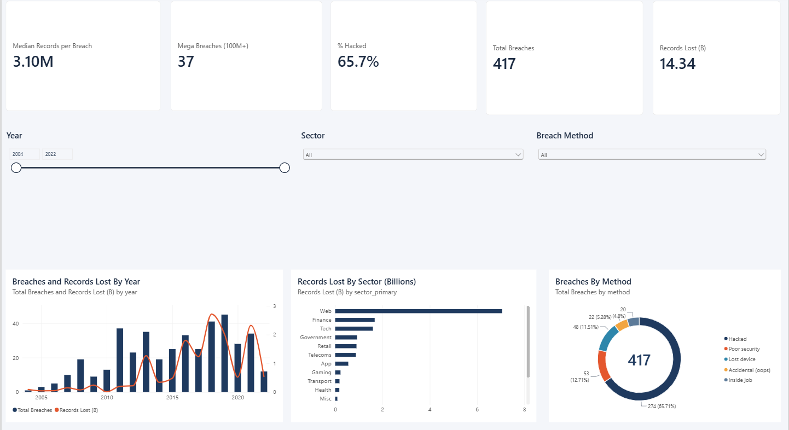
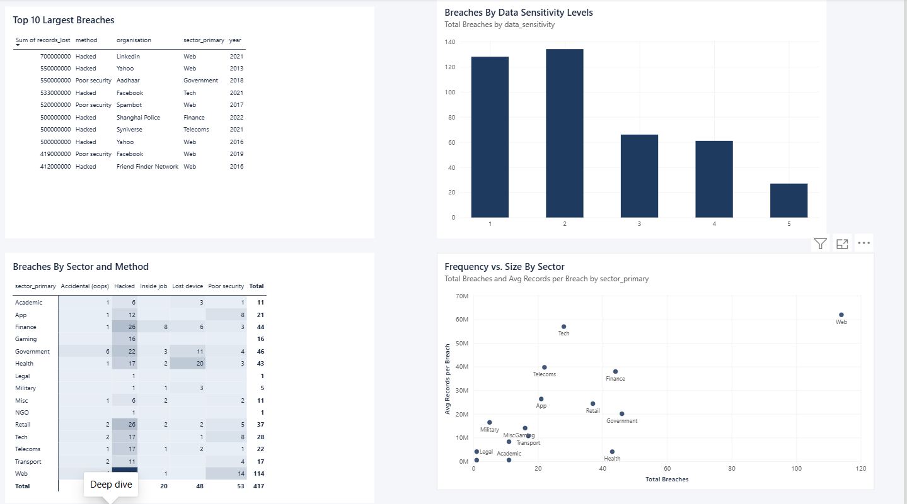
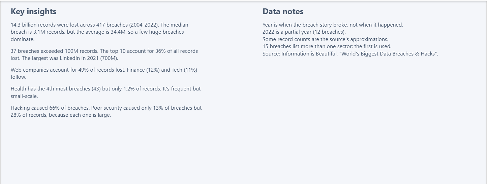

# Global Data Breaches Dashboard (Power BI)

An interactive three-page Power BI dashboard analysing 417 of the world's largest data breaches from 2004 to 2022: which sectors lose the most data, how attackers get in, and how breach sizes are distributed.



## Key findings

- **14.34 billion records** were lost across 417 breaches. The median breach exposed 3.1 million records, but the average was 34.4 million, so a small number of very large breaches dominate the total.
- **37 breaches exceeded 100 million records.** The 10 largest account for 36% of all records lost. The largest was LinkedIn in 2021 (700M), followed by Aadhaar (2018) and Yahoo (2013), each at 550M.
- **Web companies account for 49% of records lost** (7.06B across 114 breaches), followed by Finance (12%) and Tech (11%).
- **Health has the 4th most breaches (43) but only 1.2% of records lost.** It is frequent but small in scale (about 4M records per breach on average).
- **Hacking caused 66% of breaches and 65% of records.** "Poor security" caused only 13% of breaches but 28% of records, because each incident was very large.
- **Busiest years:** most breaches in 2019 (45); most records lost in 2018 (2.72B).

## Dashboard pages

| Page | What it shows |
|---|---|
| **Overview** | KPI cards (total breaches, records lost, median breach, 100M+ breaches, % hacked), breaches and records lost by year, records lost by sector, breaches by method, and slicers for year, sector and method |
| **Deep dive** | Top 10 largest breaches, breaches by sector and method (heatmap), frequency vs. average size by sector, and breaches by data sensitivity level |
| **Insights** | Written findings and data notes |




## Data

- **Source:** "World's Biggest Data Breaches & Hacks" by Information is Beautiful (Kaggle copy), https://informationisbeautiful.net/visualizations/worlds-biggest-data-breaches-hacks/
- **Raw file:** 418 rows including one legend row
- **Cleaned file:** `breaches_clean.csv` (417 breaches, 16 columns)

### Cleaning steps (done before loading into Power BI)

- Removed the instruction/legend row and two empty or helper columns.
- Converted `records lost` from text such as "15,000,000" to numbers.
- Converted the month text (for example "Aug 2022") to a real date.
- Standardised labels: `financial` to `finance`, `healthcare` to `health`, `oops!` to `Accidental (oops)`, and merged variants with stray spaces in sector and method.
- Added `sector_primary` (first listed sector) and `sector_all`, because 15 breaches list more than one sector.
- Repeated organisation names (for example Facebook, Yahoo) are separate breaches in different years and were kept.

## DAX measures

```dax
Total Breaches = COUNTROWS ( breaches )
Total Records Lost = SUM ( breaches[records_lost] )
Records Lost (B) = DIVIDE ( [Total Records Lost], 1000000000 )
Median Records per Breach = MEDIAN ( breaches[records_lost] )
Mega Breaches (100M+) = CALCULATE ( [Total Breaches], breaches[records_lost] >= 100000000 )
% Hacked = DIVIDE ( CALCULATE ( [Total Breaches], breaches[method] = "Hacked" ), [Total Breaches] )
Avg Records per Breach = DIVIDE ( [Total Records Lost], [Total Breaches] )
```

## Caveats

- `year` is the year the breach story broke, not when it happened (for example the Yahoo 2013 breach was reported in 2016).
- 2022 is a partial year (12 breaches), so it should not be read as a decline.
- The source approximates some unknown record counts, so figures are estimates.
- Sector labels are as published by the source (for example Shanghai Police is tagged Finance).
- The dataset covers well-known, publicly reported breaches, so it is not a complete picture of all breaches.

## Files

- `Data Breaches Dashboard.pbix`: the Power BI report (open with Power BI Desktop, which is free)
- `breaches_clean.csv`: the cleaned dataset
- `breaches_theme.json`: the custom report theme
- `screenshots/`: images of each report page

## Tools

Power BI Desktop (data model, DAX, visuals), Python/pandas (data cleaning).

## Author

Kasthuri Kotla | https://www.linkedin.com/in/kasthuri-kotla-192119313
